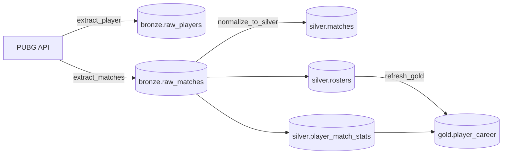

# PUBG Data Pipeline

A data pipeline that collects match statistics from the [official PUBG API](https://documentation.pubg.com/), stores the raw data in PostgreSQL and transforms it into analytical tables following the **medallion architecture** (Bronze → Silver → Gold). Orchestration runs on **Apache Airflow**, and the whole environment starts with **Docker Compose**.

## Stack

| Layer | Technology |
|---|---|
| Orchestration | Apache Airflow 2.8 (LocalExecutor) |
| Storage | PostgreSQL 16 |
| Ingestion / transformation | Python 3.11, `requests`, `psycopg2` |
| Infrastructure | Docker Compose |

## Architecture



### Layers

- **Bronze**: API JSON payloads stored as `JSONB`, untransformed. It is the source of truth and lets everything be reprocessed without calling the API again.
- **Silver**: a normalized relational model with keys and constraints:
  - `silver.matches`: match metadata (mode, map, duration, date)
  - `silver.rosters`: the teams in each match, with placement and win
  - `silver.player_match_stats`: each player's stats per match (kills, damage, distance traveled, time survived, etc.)
- **Gold**: `gold.player_career`, a materialized view with aggregated metrics per player (matches, average kills and damage, wins, personal bests).

## Airflow DAG

The `pubg_pipeline` DAG is scheduled to run daily (`@daily`, no catchup, 2 retries 5 minutes apart):

```
extract_player >> extract_matches >> normalize_to_silver >> refresh_gold
```

| Task | What it does |
|---|---|
| `extract_player` | Fetches the profile of each player in `PLAYER_NAMES`, writes it to `bronze.raw_players` and publishes the recent match IDs via **XCom** |
| `extract_matches` | Reads the IDs from XCom, downloads only the matches not yet in bronze and writes them to `bronze.raw_matches` |
| `normalize_to_silver` | Reads bronze matches not yet in silver and populates the relational tables |
| `refresh_gold` | Runs `REFRESH MATERIALIZED VIEW CONCURRENTLY gold.player_career` |

### Engineering decisions

- **Idempotency**: every load uses `INSERT ... ON CONFLICT`, and matches already ingested are skipped before the API call. Running the DAG several times on the same day neither duplicates data nor spends requests.
- **Incremental processing**: silver only processes new matches from bronze, and gold is refreshed `CONCURRENTLY`, without blocking reads.
- **Rate limiting**: the PUBG API limits requests per minute. The pipeline spaces calls according to `API_CALLS_LIMIT`.
- **Separation of concerns**: business logic lives in `src/` (ingestion, transformation, load), and the DAG only orchestrates. The same code runs outside Airflow through `src/main.py`.

## Project structure

```
.
├── airflow/
│   └── dags/
│       └── pubg_pipeline_dag.py   # DAG definition
├── sql/
│   └── 001_create_schemas.sql     # bronze/silver/gold schemas (run on Postgres's first boot)
├── src/
│   ├── ingestion/                 # PUBG API calls
│   ├── processing/                # bronze → silver transformation and gold refresh
│   ├── load/                      # Postgres connection and upserts
│   └── main.py                    # local run without Airflow
├── docker-compose.yml
├── requirements.txt
└── .env.example
```

## Getting started

### Prerequisites

- Docker and Docker Compose
- A PUBG API key, free at <https://developer.pubg.com/>

### 1. Set the environment variables

```bash
cp .env.example .env
```

Edit `.env` and fill in at least `PUBG_API_KEY` and `PLAYER_NAMES` (comma-separated player names).

| Variable | Description | Default |
|---|---|---|
| `PUBG_API_KEY` | PUBG API key | — |
| `PLAYER_NAMES` | Players to track, comma-separated | `v1t1n` |
| `PUBG_SHARD` | Platform (`steam`, `kakao`, `console`...) | `steam` |
| `API_CALLS_LIMIT` | Allowed requests per minute | `10` |
| `POSTGRES_*` | Database credentials | see `.env.example` |

### 2. Start the environment

```bash
docker compose up -d
```

This starts Postgres (with the schemas already created), initializes the Airflow metadata database and creates an admin user.

### 3. Run the DAG

1. Open <http://localhost:8080> (user `admin`, password `admin`)
2. Turn on the `pubg_pipeline` DAG
3. Trigger it manually or wait for the daily schedule

### 4. Query the data

```bash
docker compose exec postgres psql -U pubg -d pubg
```

```sql
SELECT player_name, matches_played, wins, avg_kills, avg_damage, best_kills
FROM gold.player_career
ORDER BY avg_damage DESC;
```

### Local run, without Airflow

With the compose Postgres running:

```bash
python -m venv venv
source venv/bin/activate        # Windows: venv\Scripts\activate
pip install requests python-dotenv psycopg2-binary
python src/main.py
```

> The `admin/admin` and `pubg_secret` credentials are defaults for local development. Don't use them in exposed environments.

## Next steps

- [ ] Airflow Dynamic Task Mapping to parallelize match downloads
- [ ] Unit tests for the transformations and schema validation (pydantic)
- [ ] Ingestion of match telemetry (kill events, positions, etc.)
- [ ] Gold-layer modeling with dbt
- [ ] Dashboard (Metabase/Superset) on top of the gold layer
