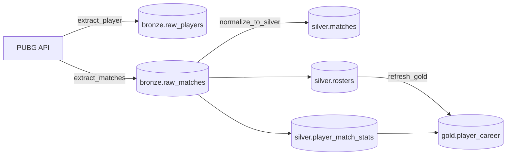

# PUBG Data Pipeline

Pipeline de dados que coleta estatísticas de partidas da [API oficial do PUBG](https://documentation.pubg.com/), armazena os dados brutos em PostgreSQL e os transforma em tabelas analíticas seguindo a **arquitetura medalhão** (Bronze → Silver → Gold). A orquestração é feita com **Apache Airflow** e todo o ambiente sobe com **Docker Compose**.

## Stack

| Camada | Tecnologia |
|---|---|
| Orquestração | Apache Airflow 2.8 (LocalExecutor) |
| Armazenamento | PostgreSQL 16 |
| Ingestão / transformação | Python 3.11, `requests`, `psycopg2` |
| Infraestrutura | Docker Compose |

## Arquitetura



### Camadas

- **Bronze**: payloads JSON da API gravados como `JSONB`, sem transformação. Serve como fonte da verdade e permite reprocessar tudo sem chamar a API de novo.
- **Silver**: modelo relacional normalizado com chaves e constraints:
  - `silver.matches`: metadados da partida (modo, mapa, duração, data)
  - `silver.rosters`: equipes de cada partida, com colocação e vitória
  - `silver.player_match_stats`: estatísticas de cada jogador por partida (kills, dano, distância percorrida, tempo vivo etc.)
- **Gold**: `gold.player_career`, uma materialized view com métricas agregadas por jogador (partidas, médias de kills e dano, vitórias, melhores marcas).

## DAG do Airflow

DAG `pubg_pipeline`, agendada para rodar diariamente (`@daily`, sem catchup, 2 retries com 5 min de intervalo):

```
extract_player >> extract_matches >> normalize_to_silver >> refresh_gold
```

| Task | O que faz |
|---|---|
| `extract_player` | Busca o perfil de cada jogador em `PLAYER_NAMES`, grava em `bronze.raw_players` e publica os IDs das partidas recentes via **XCom** |
| `extract_matches` | Lê os IDs do XCom, baixa só as partidas que ainda não estão no bronze e grava em `bronze.raw_matches` |
| `normalize_to_silver` | Lê partidas do bronze que ainda não existem no silver e popula as tabelas relacionais |
| `refresh_gold` | Executa `REFRESH MATERIALIZED VIEW CONCURRENTLY gold.player_career` |

### Decisões de engenharia

- **Idempotência**: todas as cargas usam `INSERT ... ON CONFLICT`, e partidas já ingeridas são puladas antes da chamada à API. Rodar a DAG várias vezes no mesmo dia não duplica dados nem gasta requisições.
- **Processamento incremental**: o silver só processa partidas novas do bronze, e o gold é atualizado com `CONCURRENTLY`, sem bloquear leituras.
- **Rate limiting**: a API do PUBG limita requisições por minuto. O pipeline espaça as chamadas conforme `API_CALLS_LIMIT`.
- **Separação de responsabilidades**: a lógica de negócio fica em `src/` (ingestão, transformação, carga) e a DAG só orquestra. O mesmo código roda fora do Airflow via `src/main.py`.

## Estrutura do projeto

```
.
├── airflow/
│   └── dags/
│       └── pubg_pipeline_dag.py   # definição da DAG
├── sql/
│   └── 001_create_schemas.sql     # schemas bronze/silver/gold (roda no 1º boot do Postgres)
├── src/
│   ├── ingestion/                 # chamadas à API do PUBG
│   ├── processing/                # transformação bronze → silver e refresh do gold
│   ├── load/                      # conexão e upserts no Postgres
│   └── main.py                    # execução local sem Airflow
├── docker-compose.yml
├── requirements.txt
└── .env.example
```

## Como executar

### Pré-requisitos

- Docker e Docker Compose
- Uma chave de API do PUBG, gerada gratuitamente em <https://developer.pubg.com/>

### 1. Configurar as variáveis de ambiente

```bash
cp .env.example .env
```

Edite o `.env` e preencha pelo menos `PUBG_API_KEY` e `PLAYER_NAMES` (nicks separados por vírgula).

| Variável | Descrição | Padrão |
|---|---|---|
| `PUBG_API_KEY` | Chave da API do PUBG | — |
| `PLAYER_NAMES` | Jogadores a monitorar, separados por vírgula | `v1t1n` |
| `PUBG_SHARD` | Plataforma (`steam`, `kakao`, `console`...) | `steam` |
| `API_CALLS_LIMIT` | Requisições por minuto permitidas | `10` |
| `POSTGRES_*` | Credenciais do banco | ver `.env.example` |

### 2. Subir o ambiente

```bash
docker compose up -d
```

Isso sobe o Postgres (já com os schemas criados), inicializa o banco de metadados do Airflow e cria um usuário admin.

### 3. Rodar a DAG

1. Acesse <http://localhost:8080> (usuário `admin`, senha `admin`)
2. Ative a DAG `pubg_pipeline`
3. Dispare manualmente ou aguarde o agendamento diário

### 4. Consultar os dados

```bash
docker compose exec postgres psql -U pubg -d pubg
```

```sql
SELECT player_name, matches_played, wins, avg_kills, avg_damage, best_kills
FROM gold.player_career
ORDER BY avg_damage DESC;
```

### Execução local, sem Airflow

Com o Postgres do compose rodando:

```bash
python -m venv venv
source venv/bin/activate        # Windows: venv\Scripts\activate
pip install requests python-dotenv psycopg2-binary
python src/main.py
```

> As credenciais `admin/admin` e `pubg_secret` são padrões para desenvolvimento local. Não use em ambientes expostos.

## Próximos passos

- [ ] Dynamic Task Mapping no Airflow para paralelizar o download das partidas
- [ ] Testes unitários das transformações e validação de schema (pydantic)
- [ ] Ingestão de telemetria das partidas (eventos de kill, posição etc.)
- [ ] Modelagem do gold com dbt
- [ ] Dashboard (Metabase/Superset) sobre a camada gold
